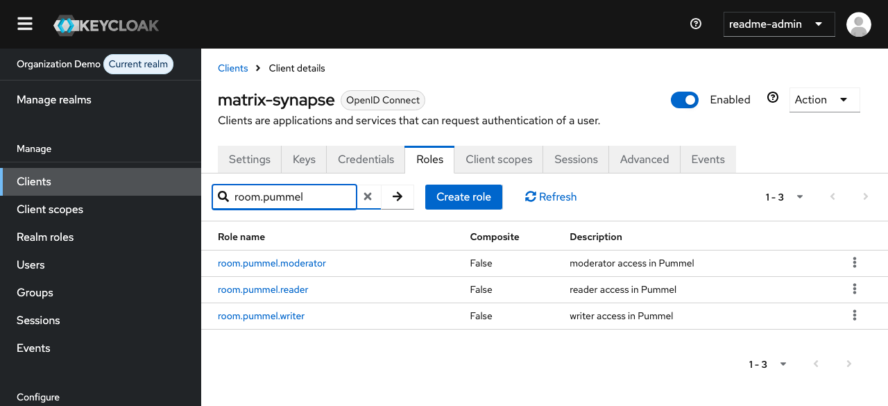
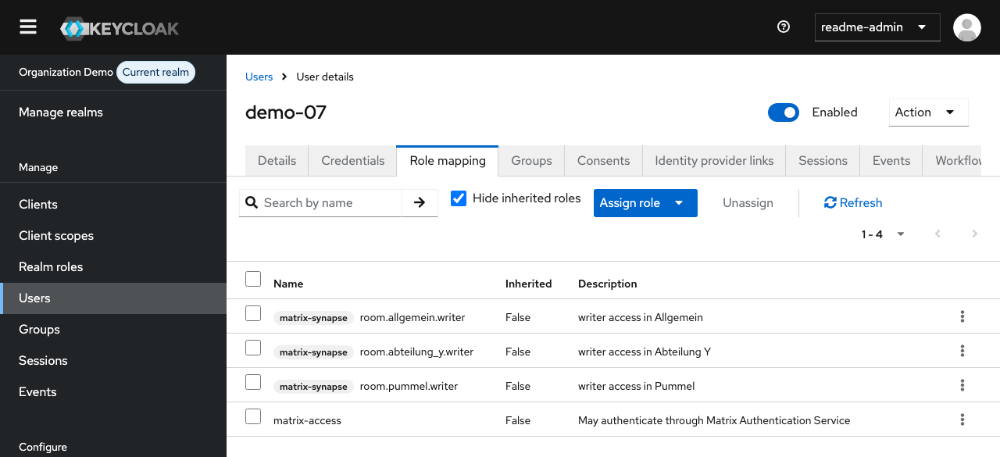
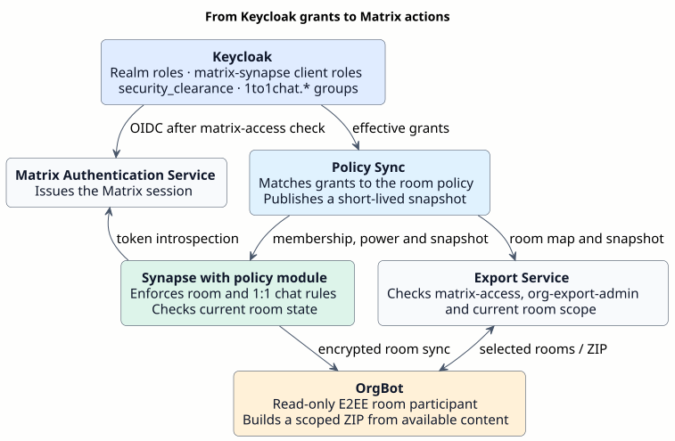
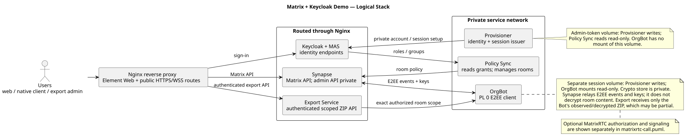

# Matrix-Keycloak-Demo: Raumzugriff mit Rollen und serverseitiger Durchsetzung

Eine freie und quelloffene Referenzbereitstellung, gepflegt von **Foldfence Studios**. Sie zeigt Keycloak-Identitäten, Matrix-Raum- und Direktchat-Policies, verschlüsselte Nachrichten und Dateien, Anrufe und begrenzten Export. Die Demo verwendet einen Realm und einen Homeserver.

[Startanleitung](#vorbereiten-und-starten) · [Dokumentationsübersicht (Englisch)](docs/README.md) · [Release Notes (Englisch)](docs/RELEASE-NOTES.md) · [English](README.en.md)

## Keycloak-Einrichtung in der Oberfläche

**Clients → `matrix-synapse` → Roles** zeigt die drei Pummel-Rollen, die der Realm-Import anlegt.



**Users → `demo-07` → Role mapping** zeigt ein synthetisches Konto mit `matrix-access` und `room.pummel.writer`. Die Realm-Rolle gibt die Matrix-Anmeldung frei. Mit ausreichender Freigabestufe erlaubt die Raumrolle das Schreiben in Pummel. [Rollenreferenz](docs/guides/ADMINISTRATION.md)



Der Ablauf zeigt, wie Policy Sync, das Synapse-Policy-Modul, der Export-Service und OrgBot diese Zuweisungen nutzen.



[Bearbeitbarer Policy-Flow](docs/diagrams/keycloak-policy-flow.puml)

## Architektur und Aufgaben



[Bearbeitbare PlantUML-Quelle](docs/diagrams/repository-overview.puml)

| Funktion | Pflegeort | Durchsetzung |
| --- | --- | --- |
| Matrix-Anmeldung | Effektive Keycloak-Realm-Rolle `matrix-access` | MAS-spezifischer Keycloak-Flow sowie MAS-Kontosperre und Sitzungsentzug über Policy Sync und Provisioner |
| Verwaltete Räume | `security_clearance`, ausdrückliche `matrix-synapse`-Clientrollen und [Policy-JSON](config/policies/room-access.json) | Policy Sync gleicht Mitgliedschaft und Power Level ab. Synapse prüft Anfragen. |
| Direktchat-Partner | Gemeinsame exakte Keycloak-Gruppen-ID mit Namen unter `1to1chat.*` | Synapse-Guard und Filter für lokale Vorschläge im mitgelieferten Element-Web-Ableger |
| Verschlüsselte Nachrichten/Dateien | Matrix-Clients und eigenes vertrauenswürdiges OrgBot-Gerät | Geräte mit den Raumschlüsseln entschlüsseln die Inhalte |
| Anrufe | Aktuelle Raumfreigabe, Mitgliedschaft, Anrufrecht und LiveKit-Konfiguration | Synapse-Guard und JWT-Dienst prüfen. LiveKit stellt Signalisierung und Medien bereit. |
| Begrenzter Export | Aktuelle Rollen `matrix-access` und `org-export-admin`, Raumumfang und Bot-Verfügbarkeit | Der Export-Service autorisiert und protokolliert. OrgBot liefert beobachtete Inhalte und Dateien. |
| White Label | [Zentrale Brand-JSON](config/branding/brand.json) und Assets | Vorbereitung erzeugt Keycloak-Theme und Element-Web-Dateien |

Der öffentliche Seed definiert **20 normale synthetische Nutzer**, **zwei isolierte Export-Testnutzer**, sechs normale verschlüsselte Räume, vier isolierte Testräume, vier Freigabestufen und drei Raumrollen. Die Vorbereitung ergänzt zwei delegierte Keycloak-Demo-Administratoren und erzeugt die Zugangsdaten lokal.

## Vorbereiten und starten

Verwende einen Linux-Host mit `amd64`, Docker Engine, Compose **ab 2.40.3**, Python **ab 3.12**, OpenSSL und genügend Ressourcen zum Bauen. Die Vorbereitung baut das gepatchte MAS-Image und erzeugt damit die Signaturschlüssel. Der Element-Web-Build benötigt entsprechend Arbeitsspeicher. [MAS-Build](deployment/mas/README.md) · [Keycloak-Build](deployment/keycloak/README.md) · [Element-Web-Build](deployment/element/README.md)

1. `python3 scripts/prepare-demo.py` ausführen. Das erzeugt private `.env`, Zugangsdaten, Realm-Import, MAS-Schlüssel, Entwicklungszertifikate und Laufzeitkonfigurationen. Der Anwendungsstack startet dabei noch nicht.
2. `.env` bearbeiten: `DEMO_HOSTNAME` auf einen erreichbaren DNS-Namen oder eine IPv4-Adresse setzen, `MATRIX_SERVER_NAME` als dauerhafte Matrix-Identitätsdomain festlegen und `LIVEKIT_NODE_IP` auf die für Clients erreichbare Adresse setzen. `demo.example.invalid` und `192.0.2.10` sind Platzhalter.
3. Für die Entwicklung die erzeugte private CA verwenden. Für eine öffentlich erreichbare Installation `TLS_MODE=provided` setzen und die vertrauenswürdige Zertifikatskette und den privaten Schlüssel über `TLS_CERT_FILE` und `TLS_KEY_FILE` hinterlegen. Bei getrenntem MAS-Host müssen beide Namen abgedeckt sein. `ADMIN_ALLOWED_CIDRS` auf das vorgesehene Verwaltungsnetz begrenzen.
4. `python3 scripts/validate-demo-config.py`, anschließend `scripts/start-demo.sh` ausführen.
5. Für den Standardpfad stehen die privaten Zugangsdaten unter `internal/deploy/local/demo-credentials.txt` und `internal/deploy/local/generated/handoff/credential-manifest.json`. Diese Dateien privat halten. `MATRIX_PUBLIC_URL` öffnen und dem Keycloak-Anmeldeweg folgen.

Die Vorbereitung leitet URLs aus `.env` ab. Hostnamen, Ports und TLS-Eingaben dort konsistent pflegen. Der Start baut Images und erstellt Dienste mit eingelesenen Konfigurationen neu. Der Keycloak-Startimport initialisiert einen neuen Realm. Für bestehende Instanzen gilt der beschriebene Update-Ablauf. [Installation](docs/guides/INSTALLATION.md)

| Einstieg | Standardpfad auf dem eigenen Matrix-Host |
| --- | --- |
| Element Web / Homeserver | `/` / `/_matrix/client/` |
| Keycloak-Anmeldung | `/auth/realms/foldfence-demo` |
| Delegierte Realm-Verwaltung | `/demo-admin` |
| Matrix Authentication Service | `/mas/` |
| Exportportal / API | `/export/` / `/_export/v1/` |

`foldfence-demo` sowie vorhandene Image-, Modul- und Endpunktnamen sind Kompatibilitätskennungen. Die mitgelieferte Branding-Konfiguration ist neutral.

## Nutzer und Policies verwalten

Matrix-Nutzer benötigen ausdrücklich `matrix-access`. Raumrollen und Direktchat-Gruppen bleiben zusätzliche, unabhängige Rechte. Neue CLI-Nutzer erhalten ohne `--matrix-access` keine Matrix-Freigabe. Reine Keycloak-Administratoren benutzen die Verwaltungskonsole.

| Raum | Mindestfreigabe | Rollen |
| --- | --- | --- |
| Allgemein | `basis` | `reader`, `writer`, `moderator` |
| Pummel | `intern` | gleich |
| Speicher | `vertraulich` | gleich |
| Leitung | `streng_vertraulich` | gleich |
| Abteilung X / Y | `basis` | gleich, mit ausdrücklicher Abteilungsrolle |

`reader` entspricht Power Level 0, `writer` 10 und `moderator` 50. Der Policy-Dienst verwaltet Mitgliedschaft und geschützten Raumzustand. Freigabestufen steuern den Zugang. Alle verwalteten Räume verwenden denselben E2EE-Algorithmus. Direktchats brauchen eine gemeinsame exakte Gruppen-ID im Namensraum `1to1chat.*`. OrgBot ist ein zusätzlicher, schreibgeschützter E2EE-Teilnehmer.

Postman oder `scripts/manage-demo-user.py` verwalten synthetische Konten, Freigabestufen, Raumrollen, Direktchat-Gruppen und Matrix-Freigaben. Der Abgleich läuft im konfigurierten Intervall, normalerweise alle 20 Sekunden. Das Ergebnis in Matrix prüfen. Entzug der effektiven Rolle `matrix-access` sperrt die verknüpfte MAS-Identität und beendet ihre regulären Matrix-Sitzungen. Bei einer geerbten Freigabe die ursprüngliche Zuweisung ändern. [Postman](api/postman/README.md) · [Rollen- und Administrationsleitfaden](docs/guides/ADMINISTRATION.md)

## Grenzen und Betrieb

Das Projekt dient als Referenz für Evaluation und Integration. Die dokumentierten Tests beziehen sich auf einen konkreten isolierten Build und synthetische Daten. Für den Produktivbetrieb prüft und verantwortet der Betreiber Identitäten, Netztrennung, TLS, Updates, Monitoring, Wiederherstellung, Medienpfade und die Rechtsgrundlage für den Export von Inhalten. [Sicherheit](docs/guides/SECURITY.md) · [Betrieb](docs/guides/OPERATIONS.md)

- OrgBot persistiert Geräte-/Kryptozustand, hält Ereignisse aber nur in einem begrenzten Arbeitsspeicher-Cache und lädt alte Historie nicht nach. Exporte können `partial` oder `unknown` bleiben. Eine ZIP-Datei belegt keine vollständige Aufbewahrung; Prüfsummen belegen geprüfte Bytes, keinen rechtlichen Beweiswert. [Exportformat und API](docs/guides/EXPORT.md).
- Rechteentzug löscht keine Inhalte oder Schlüssel auf früher berechtigten Geräten. Fehlende oder abgelaufene Policies sperren neue gesteuerte Aktionen; ein vorübergehender Ausfall ist vom bestätigten Rechteentzug getrennt.
- Anrufberechtigung und Medientransport sind getrennt. Compose enthält kein TURN-Relay. Ein schon ausgestelltes LiveKit-Token wird durch einen späteren Rollenentzug nicht nachweislich sofort ungültig. TCP/UDP/NAT-Pfade und Geräte für das eigene Ziel prüfen. [Anrufe](docs/guides/CALLS.md).
- Element Web enthält den Kontaktfilter. Native Clients können bekannte Personen oder frühere Chats lokal behalten; Synapse prüft Raumaktionen unabhängig davon. White Label ändert keine separat vertriebene Handy-App. [Native Clients](docs/guides/NATIVE-CLIENTS.md).
- Ein Compose-Netz ist keine DMZ oder VLAN-Trennung. [Netzwerkdesign](docs/architecture/network-zones.md), [Sicherheit](docs/guides/SECURITY.md) und [Betrieb](docs/guides/OPERATIONS.md) beschreiben TLS, Verwaltung, Geheimnisse, Sicherung und Updates.

## Struktur und Prüfungen

`config/` enthält wiederverwendbare Eingaben, `deployment/` die Compose-, Build- und Proxy-Vorlagen, `src/` die Dienste und portablen Tests und `web/` das Exportportal. Betreiberbefehle liegen unter `scripts/`, API-Vorlagen unter `api/postman/` und öffentliche Anleitungen und Diagramme unter `docs/`. Der private Gitea-Arbeitsbereich verwaltet versionierte Zielprofile, Übertragungsskripte, Firmenbranding und Projektnachweise unter `internal/`. Zugangsdaten und sensibler Laufzeitzustand bleiben lokal und sind von Git ausgeschlossen. Die öffentliche Installation erzeugt ihre eigenen lokalen Dateien aus dem Quellstand.

```sh
python3 scripts/validate-demo-config.py
node --test src/export-service/*.test.mjs src/policy-sync/*.test.mjs src/provisioner/*.test.mjs
python3 -m pip install --require-hashes -r src/org-bot/requirements.lock
python3 -m unittest discover -s src/org-bot -p 'test_*.py'
```

Für die portablen Node-Tests Node.js 24 verwenden. Für die OrgBot-Tests die per Prüfsumme festgelegten E2EE-Abhängigkeiten installieren, darunter das `vodozemac`-Wheel. Live-Testdaten und diensteübergreifende Abnahmeskripte bleiben intern. Auf dem Zielsystem frische Installation, Anmeldung und Rechteentzug, Raumtrennung, verschlüsselte Dateien, Exportumfang und Anrufverhalten prüfen.

Eigene Projektdateien stehen unter Apache-2.0. Markierte Ableitungen und Abhängigkeiten verwenden ihre jeweiligen Lizenzen. Foldfence Studios stellt die Software **im Ist-Zustand („AS IS“) und ohne Gewährleistung** nach Maßgabe der geltenden Lizenzen bereit. Die Veröffentlichung auf GitHub beginnt mit einem geprüften Quellstand und frischer Historie. [Lizenz](LICENSE) · [Attribution](NOTICE) · [Runtime-Hinweise](THIRD-PARTY-RUNTIME-NOTICES.md) · [Release-Ablauf](docs/guides/RELEASING.md)
