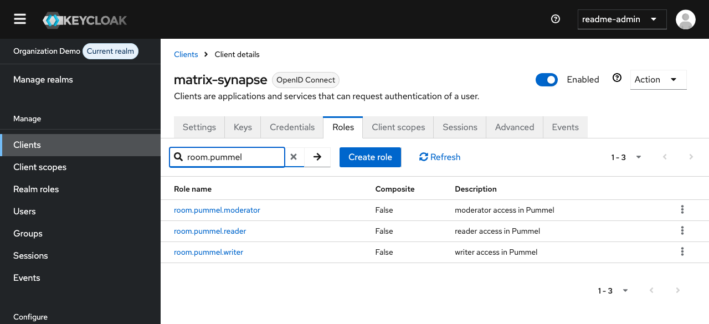
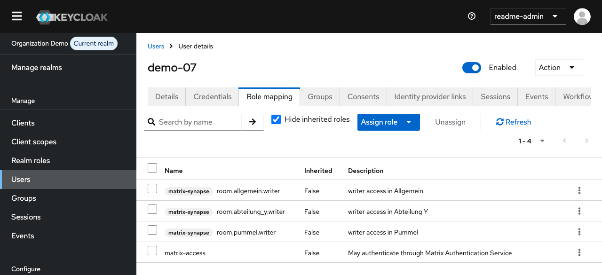
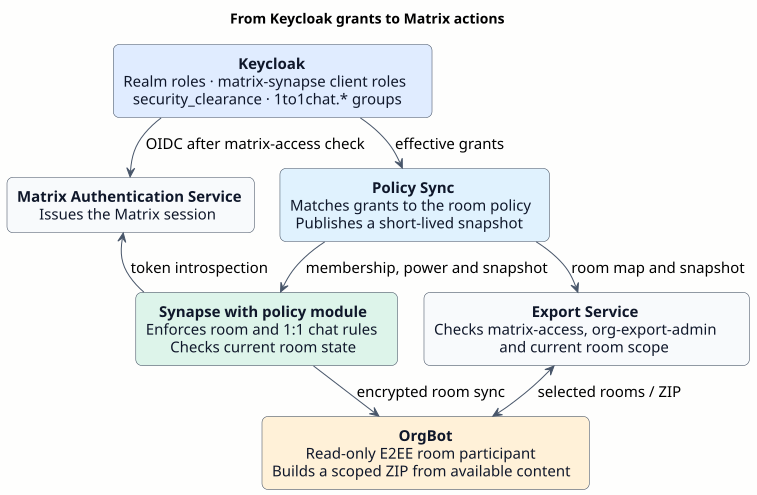
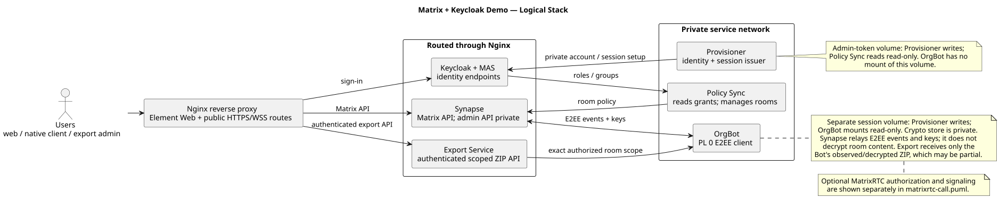

# Matrix Keycloak Demo: Role-Based Room Access and Enforcement

A free and open-source reference deployment maintained by **Foldfence Studios**. It demonstrates Keycloak identity, Matrix room and direct-chat policies, encrypted messages and files, calls, and scoped export. It uses one Keycloak realm and one Matrix homeserver.

[Install and run](#prepare-and-start) · [Documentation map](docs/README.md) · [Release notes](docs/RELEASE-NOTES.md) · [Deutsch](README.de.md)

## Keycloak setup in the UI

**Clients → `matrix-synapse` → Roles** shows the three room roles for Pummel created by the demo realm import.



**Users → `demo-07` → Role mapping** shows a synthetic account with `matrix-access` and `room.pummel.writer`. The realm role grants Matrix sign-in. With sufficient clearance, the room role grants write access in Pummel. [Role reference](docs/guides/ADMINISTRATION.md)



The flow shows how the project's Policy Sync, Synapse policy module, Export Service and OrgBot use those assignments.



[Editable policy flow](docs/diagrams/keycloak-policy-flow.puml)

## Architecture and responsibilities



[Editable PlantUML source](docs/diagrams/repository-overview.puml)

| Capability | Maintained in | Enforced by |
| --- | --- | --- |
| Matrix application admission | Keycloak effective realm role `matrix-access` | MAS-only Keycloak browser flow and MAS account lock/session withdrawal through Policy Sync and Provisioner |
| Managed-room membership and actions | Keycloak `security_clearance`, explicit `matrix-synapse` client roles, and [room policy JSON](config/policies/room-access.json) | Policy Sync reconciles membership and power. Synapse checks requests. |
| Permitted direct-chat partners | Exact shared Keycloak group ID with a `1to1chat.*` name | Synapse guard and the supplied Element Web filter for local suggestions |
| E2EE messages and files | Matrix clients and OrgBot's own trusted device | Devices possessing the room keys decrypt; the homeserver does not decrypt on their behalf |
| Calls | Current room grants, joined membership, call power, LiveKit configuration | Synapse call gate and JWT service authorize. LiveKit supplies signaling and media. |
| Scoped export | Current `matrix-access`, `org-export-admin`, room scope and Bot availability | Export Service authorizes and audits. OrgBot supplies observed content and attachments. |
| White label | [Central brand JSON](config/branding/brand.json) and assets | Preparation generates Keycloak theme and Element Web files |

The public seed defines **20 ordinary synthetic users**, **two isolated export-fixture users**, six ordinary encrypted rooms, four isolated test rooms, four clearance levels and three room roles. Preparation adds two delegated Keycloak demo administrators and generates credentials locally.

## Prepare and start

Use a Linux `amd64` host with Docker Engine, Compose **2.40.3 or newer**, Python **3.12 or newer**, OpenSSL, and sufficient build resources. Preparation builds the patched MAS image and uses it to generate signing keys. The Element Web build needs substantial memory. [MAS build](deployment/mas/README.md) · [Keycloak build](deployment/keycloak/README.md) · [Element Web build](deployment/element/README.md)

1. Run `python3 scripts/prepare-demo.py`. It creates a private `.env`, credentials, realm import, MAS keys, development TLS files and generated service configuration. It does not start the application stack.
2. Edit `.env`: set `DEMO_HOSTNAME` to your reachable DNS name or IPv4 address, `MATRIX_SERVER_NAME` to the permanent Matrix identity domain, and `LIVEKIT_NODE_IP` to a client-reachable address. The `demo.example.invalid` and `192.0.2.10` defaults are placeholders.
3. Use the generated private CA for development. For a publicly reachable installation, set `TLS_MODE=provided` and supply a trusted certificate chain and private key via `TLS_CERT_FILE` and `TLS_KEY_FILE`. Cover both service hosts if using a separate MAS hostname. Set `ADMIN_ALLOWED_CIDRS` for the intended management network.
4. Run `python3 scripts/validate-demo-config.py`, then `scripts/start-demo.sh`.
5. Read the private credentials under `internal/deploy/local/demo-credentials.txt` and `internal/deploy/local/generated/handoff/credential-manifest.json` for the default generated path. Keep these files private. Open `MATRIX_PUBLIC_URL` and follow the upstream Keycloak sign-in.

Preparation derives service URLs from `.env`. Keep hostname, port and TLS settings consistent there. Starting builds images and recreates services that load generated configuration. Keycloak startup import initializes a fresh realm. Follow the upgrade procedure for an existing instance. [Installation](docs/guides/INSTALLATION.md)

| Entry point | Default path on your Matrix origin |
| --- | --- |
| Element Web / homeserver | `/` / `/_matrix/client/` |
| Keycloak sign-in | `/auth/realms/foldfence-demo` |
| Delegated realm console | `/demo-admin` |
| Matrix Authentication Service | `/mas/` |
| Export portal / API | `/export/` / `/_export/v1/` |

`foldfence-demo` and existing image, module and endpoint names are compatibility identifiers. The supplied brand configuration is neutral.

## User and policy management

Grant `matrix-access` explicitly to a Matrix user. Room roles and direct-chat groups remain independent additional permissions. A new CLI-created user is unentitled unless `--matrix-access` is supplied. Keycloak-only administrators use the management console rather than the Messenger.

| Demo room | Minimum clearance | Roles |
| --- | --- | --- |
| General (Allgemein) | `basis` | `reader`, `writer`, `moderator` |
| Pummel | `intern` | same |
| Storage (Speicher) | `vertraulich` | same |
| Leadership (Leitung) | `streng_vertraulich` | same |
| Departments X and Y (Abteilung X / Y) | `basis` | same, with explicit department role |

`reader` is power 0, `writer` is 10, and `moderator` is 50. The policy service controls membership and protected room state. Clearance labels govern admission. All managed rooms use the same E2EE algorithm. A direct chat requires a shared exact group ID in the `1to1chat.*` namespace. OrgBot is an additional, read-only E2EE participant.

Use Postman or `scripts/manage-demo-user.py` for synthetic accounts, clearance, room roles, direct-chat groups and application entitlement. Changes converge through the configured sync interval, normally 20 seconds. Verify the resulting Matrix decision. Removing the effective `matrix-access` grant locks the linked MAS identity and terminates its ordinary Matrix sessions. For an inherited grant, change the source assignment. [Postman](api/postman/README.md) · [Administration and role reference](docs/guides/ADMINISTRATION.md)

## Boundaries and operations

This is an evaluation and integration reference. The documented tests cover a specific isolated build and synthetic data. Production operation requires the operator's own qualification of identity, network isolation, TLS, updates, monitoring, recovery, media and the legal basis for content export. [Security](docs/guides/SECURITY.md) · [Operations](docs/guides/OPERATIONS.md)

- OrgBot has persistent device/crypto state and a bounded in-memory event cache. It does not backfill historical messages. Exports can remain `partial` or `unknown`; a generated ZIP is not proof of complete retention. File hashes verify tested bytes, not legal evidentiary status. [Export format and API](docs/guides/EXPORT.md).
- Removing room access cannot erase content or keys already received. Missing/expired policy denies new controlled actions; a transient outage is distinct from a confirmed revocation.
- Call authorization is separate from media transport. This Compose project includes no TURN relay, and an already issued LiveKit token is not proven immediately invalidated by a later role change. Verify the target's TCP/UDP/NAT path and devices. [Calls](docs/guides/CALLS.md).
- The supplied Element Web applies the contact filter. Native clients can retain previously known people and conversations; server-side room authorization remains independent. White-label changes do not rebrand an independently distributed mobile app. [Native clients](docs/guides/NATIVE-CLIENTS.md).
- Compose networking alone does not create a DMZ or VLAN isolation. Use the [network design](docs/architecture/network-zones.md), [security guide](docs/guides/SECURITY.md) and [operations guide](docs/guides/OPERATIONS.md) for TLS, management access, secrets, backup and upgrades.

## Project layout and verification

`config/` contains reusable inputs, `deployment/` contains Compose, build and proxy templates, `src/` contains services and portable tests, and `web/` contains the export portal. Reusable commands live in `scripts/`, API templates in `api/postman/`, and guides and diagrams in `docs/`. The private Gitea workspace keeps tracked operator profiles, transfer tooling, organization branding and project records under `internal/`. Credentials and sensitive runtime state are local and ignored. Public startup creates its own local generated files from the source snapshot.

```sh
python3 scripts/validate-demo-config.py
node --test src/export-service/*.test.mjs src/policy-sync/*.test.mjs src/provisioner/*.test.mjs
python3 -m pip install --require-hashes -r src/org-bot/requirements.lock
python3 -m unittest discover -s src/org-bot -p 'test_*.py'
```

Use Node.js 24 for the portable Node test suite. Install OrgBot's hash-locked E2EE dependencies, including the `vodozemac` wheel, for its tests. Live fixtures and cross-service acceptance scripts remain private. On your target, verify fresh installation, admission and revocation, room isolation, encrypted file receipt, export scope and call behavior.

Original project files use Apache-2.0. Marked derivatives and dependencies use their declared licenses. Foldfence Studios provides the software **as is, without warranty** under the applicable license terms. GitHub publication starts from a reviewed source snapshot and fresh history. [License](LICENSE) · [Attribution](NOTICE) · [Runtime notices](THIRD-PARTY-RUNTIME-NOTICES.md) · [Release process](docs/guides/RELEASING.md)
