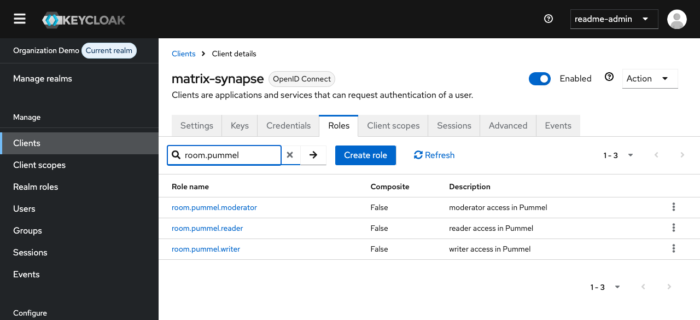
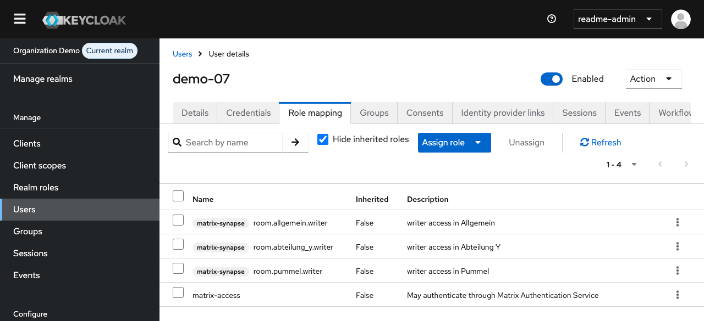
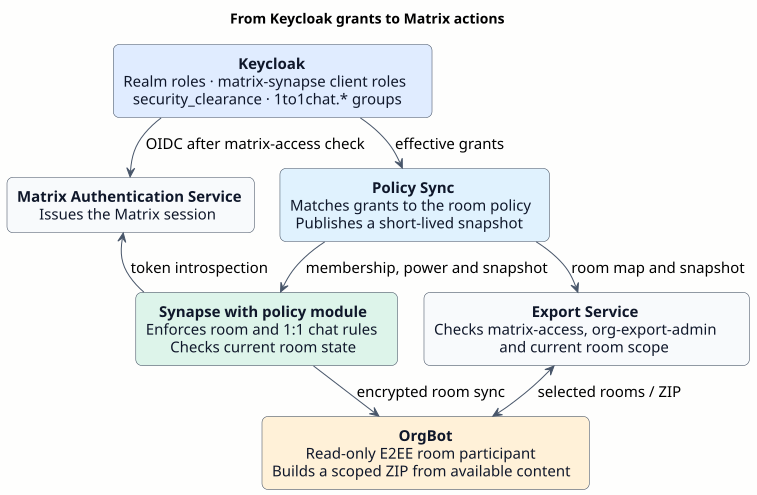

# Matrix Keycloak Demo: Role-Based Room Access and Enforcement

A free and open-source reference implementation maintained by **Foldfence Studios**. It demonstrates Keycloak sign-in, policy-controlled Matrix rooms and direct chats, end-to-end encrypted messages and files, calls, and scoped OrgBot export.

**[Install and run](README.en.md#prepare-and-start) · [English documentation](docs/README.md) · [Deutsch](README.de.md)**

## Keycloak setup in the UI

**Clients → `matrix-synapse` → Roles** shows the three room roles for Pummel created by the demo realm import.

**Users → `demo-07` → Role mapping** shows a synthetic account with `matrix-access` and `room.pummel.writer`. The realm role grants Matrix sign-in. With sufficient clearance, the room role grants write access in Pummel. [Role reference](docs/guides/ADMINISTRATION.md)

## How the policy reaches Matrix

This repository provides Policy Sync, the Synapse policy module, the Export Service and OrgBot.

[Editable policy flow](docs/diagrams/keycloak-policy-flow.puml) · [Full system overview](docs/diagrams/repository-overview.svg) · [Documentation map](docs/README.md) · [Architecture decisions](DECISIONS.md) · [Release notes](docs/RELEASE-NOTES.md)

## License and operating scope

Original project code is licensed under Apache-2.0. Marked derivatives and third-party components use their declared licenses. The software is provided **as is, without warranty** under the applicable license terms. [License](LICENSE) · [Project attribution](NOTICE) · [Runtime notices](THIRD-PARTY-RUNTIME-NOTICES.md)

Publication on GitHub uses an approved source snapshot with fresh history. The private Gitea workspace holds deployment tooling and records under `internal/`. Each installation generates its own local configuration and credentials. Production use requires separate qualification of the target environment by its operator. [Release process](docs/guides/RELEASING.md) · [Operations](docs/guides/OPERATIONS.md)
