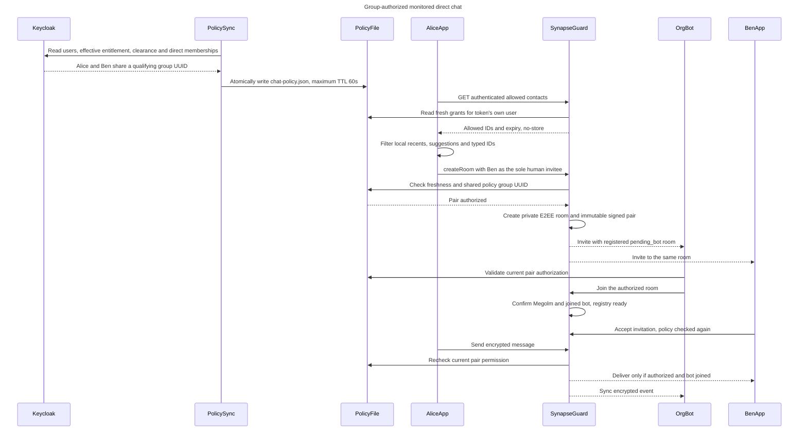
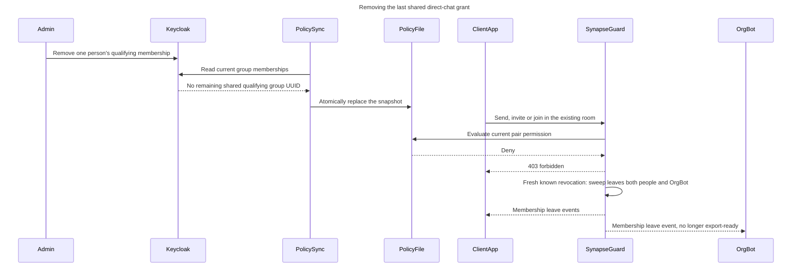
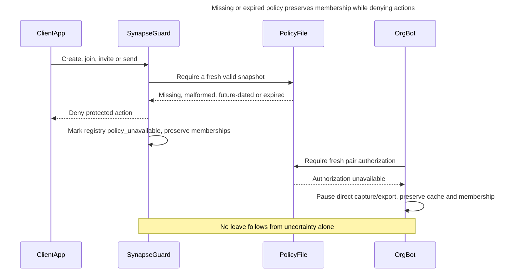

# Direct-chat policy sequence

This sequence describes the source policy for synthetic users. It is not a
deployment or acceptance report. The clients shown below are already
authenticated; MAS/Keycloak login is a separate flow. `SynapseGuard` runs
inside Synapse, not as another network service.

Keycloak administrators assign explicit groups such as
`1to1chat.orga-a.abteilung-x`. Two enabled, provisioned users with current
`matrix-access` and a recognized clearance qualify when their returned direct
memberships share the exact same qualifying group UUID. The
prefix selects eligible group names; an ordinary department group does not
grant a direct chat. Room roles and clearance remain separate permissions.

## Authorized creation and messaging

The two invitations are persisted before either client's asynchronous join is
guaranteed. The diagram shows one permitted ordering; Ben may join before the
bot. User messages stay blocked until bot membership and encryption are in
place. The client may need to retry an early send. Bot membership and registry
readiness do not prove possession of every E2EE key or a complete export.

Other user-created rooms, additional human invitees, public aliases and
third-party invitations are denied. Client-supplied room state is replaced
with the fixed private, non-federated policy. `is_direct` and `m.direct` never
grant permission. A missing or stale policy denies protected actions.

## Revocation in an existing chat

The worker waits 20 seconds between reconciliation runs by default. A snapshot
expires no later than 60 seconds after its Keycloak read began, so a failed or
slow sync cannot authorize new actions indefinitely. With a fresh snapshot
confirming loss of the last shared group, new actions are denied and the
five-second cleanup sweep ends memberships. Another
remaining shared qualifying group keeps the pair authorized. Already received
messages and device keys cannot be recalled. Reauthorization does not
automatically restore old memberships.

## Policy unavailable is not confirmed revocation

When fresh policy returns, retained authorized pairs resume. A fresh known
revocation instead follows the leave sequence above. Readiness or export may
remain unavailable during reconciliation; preserving members does not grant
new room actions. This is distinct from the whole-application login entitlement.
The example's MAS client requires the effective `matrix-access` realm role
while leaving the Keycloak account enabled. Current policy snapshots carry
that entitlement for room and export checks.

The separate `join-policy.json` exists only for initializing exact managed
group rooms. It grants narrowly scoped joins and cannot authorize direct-chat
messages or exports. See the [guard contract](../../src/synapse-policy/README.md),
the [administration guide](../guides/ADMINISTRATION.md), and the
[security guide](../guides/SECURITY.md).
