# Import, authentication, room policy, and export flow

This diagram shows the configuration and policy flow represented by the
repository. It is not a deployment or acceptance report. Runtime routes,
current policy state, and client/media behavior must be verified for each
deployment.

```mermaid
flowchart TB
  subgraph PREP[Target-specific private preparation]
    ENV[Target .env and selected brand JSON]
    SEED[Synthetic user seed]
    POLICY[Room access policy JSON]
    PREPARE[prepare-demo.py]
    KC_IMPORT[Generated Keycloak realm import]
    MAS_CONFIG[Generated MAS keys + private config]
    BRAND[Generated Keycloak theme and Element Web config]
    NGINX_CONF[Generated Nginx and TLS config]
    RTC_AS[Generated LiveKit appservice registration]
    ENV --> PREPARE
    SEED --> PREPARE
    POLICY --> PREPARE
    PREPARE --> KC_IMPORT
    PREPARE --> MAS_CONFIG
    PREPARE --> BRAND
    PREPARE --> NGINX_CONF
    PREPARE --> RTC_AS
  end

  subgraph STACK[Compose services]
    KC[Keycloak: example realm]
    MAS[Matrix Authentication Service]
    SYN[Synapse: one Matrix homeserver with chat policy guard]
    SYN_RENDER[One-shot Synapse config renderer]
    WEB[Element Web]
    PROV[Private identity provisioner: link MAS identities; issue scoped sessions]
    PS[Policy sync: reconcile managed room membership and power levels]
    BOT[OrgBot: E2EE client and ZIP producer]
    EXP[Export service: check role/scope and audit archive digest]
    NGINX[Nginx TLS reverse proxy]
    RTC_JWT[LiveKit JWT authorization service]
    RTC[LiveKit SFU]
  end

  MOBILE[Element X on Android or iOS]
  BROWSER[System browser or custom tab]
  PORTAL[Export page: Keycloak PKCE sign-in]
  MAP[Private room-map.json]
  CHAT_POLICY[Private expiring chat-policy.json]
  JOIN_POLICY[Private temporary join-policy.json]
  DIRECT_ROOMS[Private signed-pair room registry]
  ADMIN_TOKEN[Private Synapse admin-token volume: Provisioner + Policy Sync only]
  BOT_SESSION[Dedicated non-admin Bot-session volume]
  DB[Keycloak, MAS, and Synapse databases]

  SYN_TEMPLATE[Tracked Synapse YAML template] --> SYN_RENDER
  SYN_RENDER -->|config references mounted registration| SYN
  RTC_AS -->|read-only private registration| SYN
  RTC_AS -->|read-only private registration| RTC_JWT
  SYN -->|guarded native call-token request / appservice proxy| RTC_JWT
  RTC_JWT -->|candidate token and Matrix membership queries| SYN
  KC_IMPORT --> KC
  MAS_CONFIG --> MAS
  NGINX_CONF --> NGINX
  SYN_RENDER -->|rendered homeserver YAML| SYN
  BRAND --> KC
  BRAND --> WEB
  MAS -->|upstream OIDC requests| KC
  MOBILE -->|OAuth metadata request| NGINX
  NGINX -->|/_matrix/client/v1/auth_metadata| SYN
  MOBILE -->|opens OAuth authorization| BROWSER
  BROWSER -->|MAS authorization endpoint| NGINX
  MAS -->|redirects to upstream login| BROWSER
  BROWSER -->|interactive sign-in| NGINX
  NGINX -->|/auth/| KC
  KC -->|OIDC authorization response| BROWSER
  BROWSER -->|upstream callback| NGINX
  NGINX -->|/mas/upstream/callback/| MAS
  MAS -->|delegated Matrix authentication| SYN
  KC -->|Matrix entitlement, clearance, room roles and direct groups| PS
  POLICY -->|room definitions and thresholds| PS
  PROV -->|Keycloak subject lookup| KC
  PROV -->|seeded Matrix identity links| MAS
  PROV -->|verified/reused admin compatibility token| ADMIN_TOKEN
  ADMIN_TOKEN -->|private read-only mount| PS
  PROV -->|non-admin Bot session| BOT_SESSION
  BOT_SESSION -->|session-only read-only mount| BOT
  PS -->|authenticated account-linking requests| PROV
  PS -->|create/link users, encrypted rooms, membership and power levels| SYN
  PS -->|join service account and check readiness| BOT
  PS --> MAP
  PS --> CHAT_POLICY
  PS --> JOIN_POLICY
  JOIN_POLICY -->|exact managed-room join plan only| SYN
  CHAT_POLICY -->|read-only authorization snapshot| SYN
  SYN -->|approved direct-room IDs and pairs| DIRECT_ROOMS
  DIRECT_ROOMS --> BOT
  DIRECT_ROOMS --> EXP
  CHAT_POLICY --> BOT
  CHAT_POLICY --> EXP
  MAP --> BOT
  MAP --> EXP
  BOT -->|authenticated sync and media requests| SYN
  SYN -->|encrypted room events and E2EE media| BOT
  KC -->|realm and user records| DB
  MAS -->|identity links and sessions| DB
  SYN -->|rooms, state and events| DB
  BOT -->|ZIP: manifest, NDJSON, original files and completeness| EXP
  EXP -->|authenticated scoped export request| BOT
  PORTAL -->|OIDC authorization code + PKCE| KC
  PORTAL -->|Bearer API requests| NGINX
  EXP -->|fetches JWKS; verifies signed claims locally| KC
  MOBILE -->|opens Matrix and web endpoints| NGINX
  NGINX -->|Element Web asset requests| WEB
  NGINX -->|serves static export page| PORTAL
  NGINX -->|OIDC / Admin UI routes| KC
  NGINX -->|/mas/ and Matrix login/logout/refresh| MAS
  NGINX -->|Matrix client APIs and /_synapse/mas delegation| SYN
  NGINX -->|/_export/ API| EXP
  NGINX -->|native RTC and guarded SFU token requests| SYN
  SYN -->|fixed private token authorization| RTC_JWT
  RTC_JWT -->|candidate call token response| SYN
  NGINX -->|/livekit/sfu/ HTTPS/WSS signaling| RTC
  WEB -. configured TCP/UDP media path .-> RTC
  MOBILE -. configured TCP/UDP media path .-> RTC
```

The preparation step renders target-specific private files. The pinned MAS CLI generates MAS signing and encryption keys. The Compose `synapse-config` one-shot service renders Synapse YAML from its template and environment before Synapse starts. Keycloak supplies upstream sign-in and assignments. MAS accounts are linked to exact Keycloak subject IDs. The dedicated Browser flow requires `matrix-access` for the MAS client while leaving the Keycloak account enabled if the role is absent. Policy Sync includes the current entitlement in the room and export snapshot. The example disables MAS local password sign-in. The private provisioner verifies and reuses the Synapse administrator compatibility token, which MAS 1.28.0 issues without an expiry. Policy Sync mounts its volume read-only. OrgBot mounts only its separate non-admin session volume read-only. This Compose example selects Synapse as its homeserver implementation. [Installation](../guides/INSTALLATION.md)

Policy Sync reads enabled Keycloak users, effective entitlements, clearance, explicit room roles and direct group memberships, then reconciles room membership and power levels. It joins OrgBot at power level zero and waits for an authenticated readiness response describing current sync, membership and encryption state. Readiness alone leaves key coverage unproven. Direct-chat policy uses exact `1to1chat.*` group memberships in a short-lived snapshot. Synapse checks it for pair-room creation, invitations, joins, calls and events. A signed pair marker and private registry bind authorization to an actual room ID. OrgBot and Export Service recheck the current group decision. Keep the private admin API, Provisioner and OrgBot endpoints off public routes.

For export, the static page is served by Nginx, signs in through Keycloak with PKCE, and calls the Export Service. The service fetches Keycloak's JWKS to verify the signed token locally, then checks current `matrix-access`, `org-export-admin`, requested room IDs, and scope against the current room map and policy snapshot. It reloads authorization before and after requesting an archive from OrgBot. OrgBot can export only events and media its own E2EE device has decrypted and retained. Missing history, keys, metadata, or media remain `partial` or `unknown`. The service records the archive digest; use the [export guide](../guides/EXPORT.md) to verify the manifest, event tags, original file bytes, and hashes.

MatrixRTC requests enter through Nginx and Synapse's call-policy guard. The guard checks the current room grant, joined membership, Megolm encryption, and call power level before forwarding to a fixed private token path; it rechecks room policy and state after minting and before returning a token. The native Client-Server path uses Synapse's MatrixRTC application-service proxy, while an SFU path uses the private LiveKit JWT service. Nginx carries HTTPS/WSS signaling and should deny alternate public token-mint routes. The integration depends on experimental MSCs. This Compose example does not include TURN, and a working token/signaling path does not prove media transport. See the [calls guide](../guides/CALLS.md) for the separate client, firewall, NAT, and TURN checks.

The PlantUML source catalogue and local SVG renderer instructions are in [docs/diagrams/README.md](README.md).
