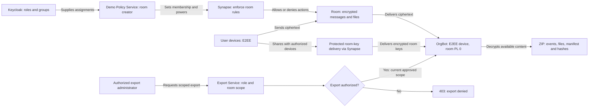

# Why the room has a policy account and OrgBot

The two service identities have separate duties. The policy service controls
membership and room state; OrgBot is an explicitly authorized E2EE recipient.
Synapse enforces the rules independently of the client interface.

| Identity | Why it is present | Authority and boundary |
| --- | --- | --- |
| `@demo-policy-admin:<server>` / Demo Policy Service | Joined creator and managed-room membership service. Policy Sync uses this account to apply membership, power-level and security-state changes from Keycloak assignments. | Privileged service identity with a private Synapse administrator token. For room v11, validate that the power-level event gives the creator at least PL 100 through `users[creator]` or `users_default`; room v12 grants immutable infinite creator power and requires the creator to be absent from `power_levels.users`. It has no interactive human password and no E2EE device; the application provisions no room decryption keys to it. It is excluded from human clearance and room-role grants. Protect its credentials as administrative secrets. |
| `@orgbot:<server>` / OrgBot (display label is configurable) | Receives encrypted events as an approved participant, maintains its own device keys, and decrypts content for authorized exports. | Room power level 0, no server-administrator role, no room management or ordinary message-writing rights. It receives only the keys shared with its device; its persistent key store is private. Export requests pass the Export Service's role and current room-scope checks and the bot's protected endpoint. |

The creator distinction follows the [Matrix creator-power rules](https://matrix.org/docs/spec-guides/creator-power-level/).
For room version 12, the creator has immutable infinite power and must be
absent from `power_levels.users`. For room version 11, when a power-level event
exists, creator authority depends on `users[creator]` or `users_default`; do not
assume that being the creator means PL 100. The configured policy account's
authority must not be confused with an ordinary user's explicit PL 100 grant.

For a managed room, a human needs Matrix entitlement, the configured clearance
and one explicit room role. For a direct chat, the eligible pair must share an
exact authorized `1to1chat.*` group. The guard requires the registered OrgBot to join
the encrypted pair room before it permits normal messages. A user cannot kick
the bot to turn an approved monitored chat into an unmonitored chat.

Room power level is an action permission, not an encryption clearance. OrgBot
can be a read-only E2EE recipient at power level 0. Synapse routes encrypted
room-key messages between devices; users' private device keys are not handed
to the policy service or to the server by this design.

The export arrow means available, authorized content. Current OrgBot history is
bounded by its observed sync/cache; missing keys, unavailable media and history
gaps are reported. Archives remain `partial`; a manifest and file hashes do not
establish complete historical retention. Verify E2EE decryption and original
attachment bytes with a synthetic fixture before relying on an export
integration.

See [direct-chat policy sequence](direct-chat-policy-sequence.md),
[OrgBot contract](../../src/org-bot/README.md),
[Synapse guard boundaries](../../src/synapse-policy/README.md), and the
[security guide](../guides/SECURITY.md).
